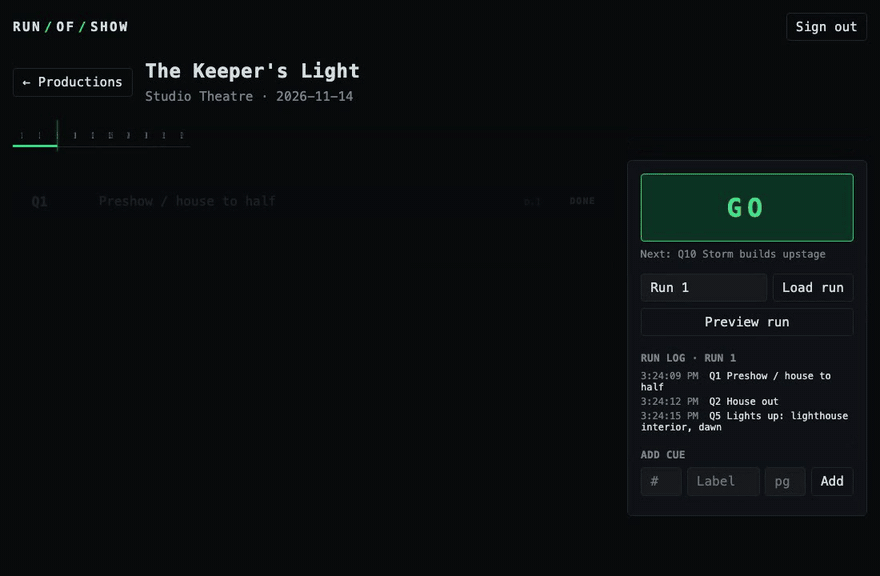

# run-of-show

A theatrical cue-calling tool. You build a cue list for a production (by hand, or imported from a spreadsheet or an ETC Eos export); during a run, a stage manager hits **GO** to fire the cues in order, and every GO, BACK, GOTO and RESET is written to an append-only run log that can be played back later with its real timing. The frontend is an animated run-of-show board. This is a personal proof project, built to practise Django and GSAP with a domain I know from nine years of running shows. It is not client work and has not been used on a real production.



## Stack

- **Backend:** Python 3.12, Django 5.2, Django REST Framework, PostgreSQL 17 (via Docker Compose)
- **Frontend:** React 19, Vite, GSAP 3 (with `@gsap/react`)
- **Tests:** pytest-django (backend), Vitest (frontend)

## Running it

You need Docker, Python 3.12, and Node 20.19+ or 22.12+.

**Database**

```bash
docker compose up -d --wait
```

**Backend** (http://localhost:8000)

```bash
cd backend
python3.12 -m venv .venv
.venv/bin/pip install -r requirements.txt
cp .env.example .env
.venv/bin/python manage.py migrate
.venv/bin/python manage.py seed_demo
.venv/bin/python manage.py runserver
```

`seed_demo` creates a local demo user (`demo` / `curtain-up`) and a sample production with ten cues. It is safe to run more than once. For the Django admin, create a superuser with `manage.py createsuperuser`.

**Frontend** (http://localhost:5173)

```bash
cd frontend
npm install
npm run dev
```

The login form is prefilled with the demo account. Set `VITE_API_URL` (see `frontend/.env.example`) if the API is not on `localhost:8000`.

**Tests**

```bash
cd backend
.venv/bin/pytest
```

```bash
cd frontend
npm test
```

## Backend

Four models in `backend/shows/models.py`, all registered in the Django admin:

- `Production`: owner, name, company, venue, performance date, notes
- `Cue`: number (a decimal, so `12.5` sorts between `12` and `13`), label, script page, notes, scene, and timing as on Eos: up time, down time, Eos's total duration, and follow or hang (`F2`, `H3`). Cues are always ordered by number.
- `Run`: one rehearsal or performance of a production (label such as "Preview 1", kind, start and end)
- `CueEvent`: one operator action in a run (GO, BACK, GOTO or RESET), with the cue it made active and a timestamp

The schema is in the committed migrations in `backend/shows/migrations/`. `0003` is a data migration that moved the original free-text run labels into `Run` rows.

| Method | Path | Purpose |
| --- | --- | --- |
| `POST` | `/api/auth/token/` | Exchange username and password for an API token |
| `GET` `POST` | `/api/productions/` | List or create your productions |
| `GET` `PUT` `PATCH` `DELETE` | `/api/productions/{id}/` | One production |
| `GET` `POST` | `/api/productions/{id}/cues/` | List or add cues |
| `GET` `PUT` `PATCH` `DELETE` | `/api/cues/{id}/` | One cue |
| `GET` `POST` | `/api/productions/{id}/runs/` | List or start runs |
| `GET` `PATCH` | `/api/runs/{id}/` | One run, with its event log and current state |
| `POST` | `/api/runs/{id}/go/` | Fire the next cue, or the cue given as `{"cue": id}` |
| `POST` | `/api/runs/{id}/back/` | Step back to the previous cue |
| `POST` | `/api/runs/{id}/goto/` | Fire the cue given as `{"cue": id}` |
| `POST` | `/api/runs/{id}/reset/` | Clear the active cue |
| `POST` | `/api/runs/{id}/end/` | End the run; it then refuses further actions |
| `POST` | `/api/productions/{id}/cues/import/` | Import cues from CSV (dry run unless `dry_run=false`) |
| `GET` | `/api/productions/{id}/cues/export/` | Download the cue list as CSV |
| `GET` | `/api/runs/{id}/export/` | Download a run log as CSV |

Every endpoint requires authentication (DRF token or session). Querysets are filtered to the requesting user, so another user's production, cue or run returns 404. The server decides which cue is next: it locks the run row for each action, so two GOs at once can't fire the same cue.

**About "append-only":** this is enforced in the application layer, not the database. `CueEvent.save()` refuses to update an existing row, `CueEvent.delete()` raises, the API has no update or delete route for events, and the admin is read-only for them. The database does not block `UPDATE` or `DELETE`, and deleting a production or run cascades through its events. Each event keeps a copy of the cue's number and label, so editing or deleting a cue later does not change the log.

**CSV import** (`backend/shows/csv_io.py`) reads two formats. A simple CSV needs a header row with a `number` column, and may have `label`, `page`, `scene`, `notes`, `time`, `down_time`, `duration` and `follow` (times in seconds or `m:ss`); that is also what export writes, so an export can be edited in a spreadsheet and brought back. An **ETC Eos CSV export** (cues only, or a whole show file) is recognised by its `START_…` sections: cues come from the TARGETS section, one cue list at a time since numbers repeat across lists, part rows are skipped, and label, cue notes, scene text, time, down time, duration and follow are kept. Eos's duration is its own total for the cue, counting delays, discrete times and parts; it is what the board times the cue by, and it is cleared when a cue's time is edited here (in the app or by an import without a duration), since it can't be recomputed without those details. Every import is planned first and shown as a dry run (create, update, unchanged, delete, rejected with a reason), then planned again against the current cue list when it's applied. **Merge** adds and updates but never blanks a field (Eos leaves most labels empty); **replace** makes the file the whole cue list. The Eos reader has been checked against real exports from two shows, the larger a full show file with 10 cue lists, 401 cues in the main list, point cues, part cues, labels, scene text and cue notes; the tests use synthetic fixtures with the same shape.

The tests in `backend/shows/tests.py` cover: actions add events without changing earlier ones; unauthenticated writes get 401; one user cannot see or change another user's data; numeric cue ordering; cue editing and duplicate numbers; GO, BACK, GOTO and RESET at both ends of the list; log entries surviving a cue being renamed or deleted; ended runs; and the data migration rejecting bad cue numbers. `backend/shows/test_csv.py` covers both import formats, merge versus replace, rejected rows, export round trips, run logs surviving a replace import, and owner-only access.

## Frontend

Two screens, with URLs that survive a reload (React Router): the productions list at `/`, and the run-of-show board at `/productions/{id}/runs/{run}` (`frontend/src/Board.jsx`).

Running a show (Live mode):

- Each card shows the cue's time the way Eos does (`5`, or `5/3` for up/down), any follow or hang, and Eos's total when it is longer than the time. When a cue goes, a bar along the bottom of its card fills over that total, so you can see when the cue has finished. The board shows follows and hangs but never fires them.
- **GO** (or Space) fires the next cue. **Clicking a cue loads it**: it becomes the cue GO will fire, and nothing fires until GO. ↑ and ↓ move the load; Esc clears it.
- **BACK** (B or ←) steps to the previous cue. **GOTO** fires the cue whose number is typed in its box (G jumps to the box). **RESET** clears the active cue. All three are recorded in the log alongside GOs.
- The **run picker** switches between runs, starts a new one (label and kind), or ends the current one. An ended run is read-only. **Export** downloads the run's log, with seconds from the first event.

The board has two modes, like Live and Blind on a lighting console:

- **Live** shows the cue list as cards, with scene dividers and cue notes, and is where the show is run.
- **Edit** turns the cue list into inline fields (number, label, time, follow or hang, page, scene, notes). Time takes `5`, `5/3` or `1:30`. A field saves on Enter or when it loses focus, Esc puts it back, delete asks for a second click, and new cues land in number order. **Import CSV…** opens a dialog that previews every change before anything is written; **Export CSV** downloads the list. The production's details are edited from the board header; deleting a production means typing its name.

The Vitest tests cover the board's state helpers (`frontend/src/board/state.js`), cue time parsing and formatting (`frontend/src/board/cueTime.js`), and the step builder that turns a log into playback (`frontend/src/board/playbackSteps.js`).

The GSAP techniques used on the board:

- **Stagger:** on load, `gsap.from()` with `stagger` brings the cue cards in one after another.
- **Tweens:** GO posts to the run's `go/` endpoint, then `gsap.to()` moves each card between its pending, standby, active, and complete looks (colour, border, opacity, scale), slides the playhead along the track, and `gsap.fromTo()` adds a flash on the cue that just went. The space bar also works as GO.
- **Timeline playback:** "Play back this run" turns the run's log into one `gsap.timeline()`: every card change and playhead move is a tween placed at the real time it happened (`frontend/src/board/Playback.jsx`). Speed (1×, 2×, 5×, 20×) is `timeScale()`, the scrubber is `progress()`, and pause and play are the timeline's own. The clock and scrubber are written to the DOM from `onUpdate` rather than through React state, so playback doesn't re-render the board every frame. A run with nothing recorded plays an evenly spaced preview instead. Playback writes nothing to the log, and Stop returns the board to the run's live state.
- **Fade bars:** GO and GOTO run a linear `fromTo()` on the card's bar for the cue's duration; BACK runs it for one second, and the next action cuts it off. In playback each bar is a tween in the timeline too, ending where the next action cut it. Lag smoothing is off (`gsap.ticker.lagSmoothing(0)`), so after a stalled frame a bar jumps to where real time says it is instead of falling behind. A run with nothing recorded previews each cue for its own duration.
- `useGSAP` and `contextSafe` from `@gsap/react` scope the animations to the component so they are cleaned up on unmount.
- The card looks (`frontend/src/board/looks.js`) are frozen objects copied into every GSAP call, because GSAP writes into the vars object it is given; sharing one would let a timeline quietly change the looks for every later tween.

## Not included

There is no deployment, no real-time sync between several operators, no user sign-up, and no production hardening (the settings are for local development). These, and show-control input from an Eos console, are tracked as [GitHub issues](https://github.com/aeiti/run-of-show/issues).
